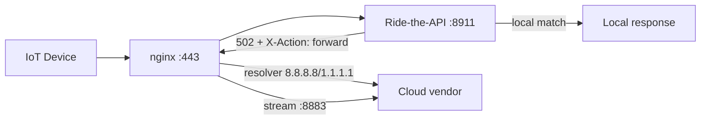

# Deployment Guide — Ride-the-API

> Local cloud replacement proxy: intercepts IoT traffic, learns protocols
> via LLM and responds locally.

## Table of Contents

- [Prebuilt binaries (all platforms)](#prebuilt-binaries-all-platforms)
- [Direct Execution](#direct-execution-python--m-coreserverpy)
- [Docker](#docker)
- [Docker Compose with nginx Sidecar](#docker-compose-with-nginx-sidecar)
- [Volumes and Persistence](#volumes-and-persistence)
- [Networks](#networks)
- [Environment Variables](#environment-variables)
- [GPU Support](#gpu-support)
- [Systemd (Linux)](#systemd-linux)
- [Troubleshooting](#troubleshooting)

---

## Prebuilt binaries (all platforms)

> **New to the project?** The [Quick Start](quickstart.md) is the recommended
> starting point — it covers the one-command install from source (section A1).
> This section describes the prebuilt-binary route in detail.

Each GitHub **release ships prebuilt bundles** for Linux (x64/arm64), macOS
(arm64) and Windows (x64) — produced by `.github/workflows/build-platforms.yml`
and attached to the release under stable names:

| Asset | Platform |
|-------|----------|
| `ride-the-api-linux-x64.tar.gz` | Linux x86_64 |
| `ride-the-api-linux-arm64.tar.gz` | Linux arm64 — **a proxy host 64-bit** |
| `ride-the-api-macos-arm64.tar.gz` | macOS arm64 (Apple Silicon) |
| `ride-the-api-windows-x64-setup.exe` | Windows x64 (Inno Setup installer) |

Use the **one-shot installer scripts** to fetch and install the **latest**
release. Rerunning the same script upgrades to a newer release **in place,
preserving `config/`, `data/`, `certs/` and `logs/`**.

### Linux / macOS / a proxy host — `deploy/rideapi`

```bash
curl -sSL https://raw.githubusercontent.com/thcuba/Ride-the-api/main/deploy/rideapi -o rideapi
bash rideapi            # → installs the latest release into ~/ride-the-api
bash rideapi --systemd  # optional: also write a systemd user service
```

Options:

| Option | Description |
|--------|-------------|
| `--version <tag>` | Install a specific release tag (default: latest) |
| `--dir <path>` | Install directory (default: `$HOME/ride-the-api`) |
| `--systemd` | Write a systemd user unit that runs it as a service |

> **Installed version:** the script writes the installed release tag to
> `<install-dir>/VERSION`, which `GET /health` reports under `version` (the
> dashboard "Software update" card reads it). For source installs (`bootstrap.sh`
> / git) the tag or short SHA is written the same way.
| `RTA_VERSION` / `RTA_DIR` | Environment overrides for the same flags |

> **Self-update from the UI.** The web "Update" button runs `deploy/update.sh`
> detached. When launched from a **frozen bundle**, PyInstaller sets
> `LD_LIBRARY_PATH` to `_internal/`, which shadows the system OpenSSL and makes
> the bundle's spawned `curl` exit at startup ("libssl.so.3: version
> `OPENSSL_3.x' not found") — the update silently failed with "Download release
> fallito". The server now strips those loader-path vars from the updater's
> environment (`updater_env()`), and the install/update scripts defensively
> `unset` them too, so the update works from a bundle as it does from a shell.

On any supported 64-bit Linux (a proxy host OS, **Debian**, Ubuntu, Fedora,
Arch), the recommended one-command install is **from source** via the unified
bootstrap script — it detects the distro and package manager (via
`/etc/os-release`), verifies the architecture (a proxy host OS requires
`arm64/aarch64`), clones the repo, creates a Python virtualenv with all
dependencies, and registers an auto-start service.
See [Quick Start section A1](quickstart.md#a1-linux-single-board-host-fully-automatic-install-from-source):

```bash
curl -fsSL https://raw.githubusercontent.com/thcuba/Ride-the-api/main/deploy/bootstrap.sh -o bootstrap.sh
bash bootstrap.sh            # install from source + auto-start service (default)
```

Run in the foreground for a quick test with `--fg`.

Alternatively, install the **prebuilt bundle** as a user service:

```bash
curl -sSL https://raw.githubusercontent.com/thcuba/Ride-the-api/main/deploy/rideapi -o rideapi
bash rideapi --systemd
systemctl --user enable --now ride-the-api
```

> **Pi 4 / 2GB RAM note:** the base install is lightweight (excludes the unused
> `onnxruntime`), and LLM inference is meant to run **off-box via API cloud** —
> a local 8B-class Ollama model (e.g. `llama3.1:8b`, ~6GB) does not fit a 2GB
> Pi; if you do run a local model, pick a small one that is actually installed
> (check with `ollama list`). The default profile already points at an
> OpenAI-compatible endpoint.
>
> **Prebuilt vs source:** the LLM client (`openai` SDK) requires the classic
> `httpx` (0.x). A prebuilt bundle built against `httpx2` makes **every** LLM
> connection test fail with `Connection error.` while the same call works from a
> shell — that is a build/dependency issue, not a config one. Prefer the
> source bootstrap below (`deploy/bootstrap.sh`);
> `tests/test_llm_runtime_deps.py` guards the `openai`↔`httpx` contract in CI.

### Verifying a prebuilt download

The installer runs the bundle it downloads, so it verifies the artefact first. Every release
publishes a `SHA256SUMS` file next to the platform archives; the installer fetches it and refuses to
proceed when the digest is missing or does not match. It also inspects the archive listing and
refuses to extract one containing absolute or parent-relative paths, because `tar` would follow them
out of the extraction directory.

Both checks fail closed: a release without `SHA256SUMS`, or an asset that does not match it, is not
installed.

### Privileged ports without root

Interception binds 443/8883 and DNS binds 53, all below 1024. Do **not** use `setcap` on the
interpreter binary: that grants the capability to every invocation of that Python, for any user and
any script, permanently. The shipped unit requests it for this service only:

```ini
AmbientCapabilities=CAP_NET_BIND_SERVICE
CapabilityBoundingSet=CAP_NET_BIND_SERVICE
```

If the capability was previously set on the binary, remove it after switching:

```bash
sudo setcap -r "$(readlink -f "$(command -v python3)")"
```

### Windows — `deploy/install.ps1`

```powershell
# In PowerShell
Invoke-WebRequest https://raw.githubusercontent.com/thcuba/Ride-the-api/main/deploy/install.ps1 -OutFile install.ps1
powershell -ExecutionPolicy Bypass -File .\install.ps1          # latest, GUI installer
powershell -ExecutionPolicy Bypass -File .\install.ps1 -Silent  # silent install
```

### Installing from source (alternative)

If you prefer to build from source instead of using a prebuilt bundle, see the
[Direct Execution](#direct-execution-python--m-coreserverpy) section below.

---

## Direct Execution (`python -m core.server`)

Suitable for development or single host without containers.

### Prerequisites

- Python ≥ 3.11
- Pip / uv
- Git

### Installation

```bash
# Clone the repository
git clone https://github.com/thcuba/Ride-the-api.git
cd Ride-the-api

# Create and activate a virtual environment
python3 -m venv .venv
source .venv/bin/activate  # Linux/macOS
# .venv\Scripts\activate   # Windows

# Install the package in editable mode
pip install -e .
```

### Configuration

```bash
# Copy the example configuration file
cp config/config.yaml config/config.yaml  # already present

# Edit config/config.yaml:
# - Set the LLM API key (OpenAI-compatible)
# - Configure vendors and their cloud endpoints
# - Adjust the learning mode
```

The `config/config.yaml` file follows the structure documented in [configuration.md](configuration.md).

### Startup

```bash
python -m core.server
```

The server starts on `http://0.0.0.0:8911` (configurable in `config.yaml`).

### DNS Setup (required for interception)

To intercept IoT device traffic, you must point their cloud domains to the
proxy's IP address. Recommended methods:

#### a local DNS server

```bash
# /etc/a local DNS server.d/ride-api.conf
address=/mqtt.example.com/192.168.1.100
address=/api.example.com/192.168.1.100

sudo systemctl restart a local DNS server
```

#### a DNS filter / an external DNS filter Home

Add custom rewrites:
```
mqtt.example.com → 192.168.1.100
api.example.com  → 192.168.1.100
```

#### iptables (alternative)

If you cannot modify DNS, redirect ports directly:

```bash
iptables -t nat -A PREROUTING -d 192.168.1.100 -p tcp --dport 443 -j REDIRECT --to-port 8911
iptables -t nat -A PREROUTING -d 192.168.1.100 -p tcp --dport 8883 -j REDIRECT --to-port 8911
```

---

## Docker

### Building the image

```bash
# CPU (default)
docker build -f deploy/Dockerfile -t ride-the-api:latest .

# GPU (NVIDIA CUDA)
docker build --target=production-gpu -f deploy/Dockerfile -t ride-the-api:gpu .
```

The multi-stage Dockerfile offers three targets:

| Target | Description |
|--------|-------------|
| `base` | Python dependencies + compilation |
| `gpu` | Base + CUDA 12.4, TensorRT, ONNX Runtime GPU |
| `production` | **(default)** Minimal production image (CPU) |
| `production-gpu` | Production with GPU |

### Running a single container

```bash
# Create directories for persistent data
mkdir -p data/devices data/core certs models logs

# Start the container
docker run -d \
  --name ride-the-api \
  --restart unless-stopped \
  -p 8911:8911 \
  -p 8080:8080 \
  -v "$(pwd)/config:/app/config:ro" \
  -v "$(pwd)/data:/app/data" \
  -v "$(pwd)/certs:/app/certs:ro" \
  -v "$(pwd)/models:/app/models:ro" \
  -v "$(pwd)/logs:/app/logs" \
  -e LOG_LEVEL=INFO \
  -e CONFIG_PATH=/app/config/config.yaml \
  ride-the-api:latest
```

> **Important — data paths in Docker.** The container mounts the host `./data`
> directory at `/app/data`, but the **default** `config/config.yaml` points the
> core database and per-device DBs at `./ridebase/` (i.e. `/app/ridebase/`
> inside the container), which is **not** covered by the `/app/data` volume.
> For data to persist across container restarts, edit `config/config.yaml` so
> the `core` section uses the mounted paths:
>
> ```yaml
> core:
>   database_url: "sqlite+aiosqlite:////app/data/core.db"
>   device_db_dir: "/app/data/devices"
> ```
>
> and set `tls_decrypt.device_certs_dir` to `/app/data/device_certs`.

### Health check

The container exposes an automatic health check every 30 seconds at `http://localhost:8911/health`.

Ports exposed by the container:

| Port | Usage |
|------|-------|
| 8911 | Main proxy (traffic interception) |
| 8080 | Health check / dashboard |
| 9090 | Prometheus metrics |

---

## Docker Compose with nginx Sidecar

The recommended architecture for production includes an nginx reverse proxy as a sidecar.
nginx handles:

1. TLS termination (port 443)
2. Routing device traffic to Ride-the-API (internal port 8911)
3. Forwarding misses to the cloud vendor via a dedicated DNS resolver (8.8.8.8 / 1.1.1.1),
   **avoiding DNS loops** with the local DNS (a local DNS server / a DNS filter)

### Startup

```bash
docker compose -f deploy/docker-compose.yml up -d
```

The Compose file builds the **CPU** stage (`target: production`) — without an
explicit target, Compose would build the Dockerfile's last stage,
`production-gpu`. It also mounts `../ridebase` at `/app/ridebase`, where the
learned state lives (core database + per-device databases): without that mount
it would stay in the disposable container layer and be lost whenever the
container is replaced.

On the very first start, while no control-plane password is set, the API logs a
**one-time setup token** (also written to `ridebase/setup-token`, mode `0600`).
Paste it into the setup dialog of the UI, or send it as the `X-Setup-Token`
header, to create the password — see [api.md](api.md#first-run-password-setup-post-apiauthpassword).

### Services

#### `ride-the-api` (main server)

```yaml
ride-the-api:
  build:
    context: ..
    dockerfile: deploy/Dockerfile
  container_name: ride-the-api
  restart: unless-stopped
  ports:
    - "8080:8080"      # Health/dashboard (optional, remove for security)
  volumes:
    - ../config:/app/config:ro
    - ../data:/app/data
    - ../certs:/app/certs:ro
    - ../models:/app/models:ro
    - ../logs:/app/logs
  environment:
    - PYTHONUNBUFFERED=1
    - LOG_LEVEL=INFO
    - CONFIG_PATH=/app/config/config.yaml
```

#### `nginx` (reverse proxy sidecar)

```yaml
nginx:
  image: nginx:alpine
  container_name: ride-the-api-nginx
  restart: unless-stopped
  ports:
    - "80:80"
    - "443:443"
    - "8883:8883"      # MQTT over TLS (stream proxy)
  volumes:
    - ../deploy/nginx.conf:/etc/nginx/nginx.conf:ro
    - ../certs:/etc/nginx/certs:ro
  depends_on:
    - ride-the-api
```

#### `postgres` (optional — centralized database)

Commented out in the default docker-compose.yml. Enable it to use PostgreSQL instead of
per-device SQLite databases:

```yaml
postgres:
  image: postgres:16-alpine
  environment:
    POSTGRES_DB: ride_the_api
    POSTGRES_USER: ride_the_api
    POSTGRES_PASSWORD: ${POSTGRES_PASSWORD}
  volumes:
    - postgres_data:/var/lib/postgresql/data
```

### Traffic flow with nginx



When Ride-the-API does not recognize a request and `signal_forward_to_cloud` is enabled,
it returns HTTP 502 with the header `X-Action: forward`. nginx intercepts the error and
re-forwards the request to the cloud vendor using a dedicated DNS resolver (Google 8.8.8.8 /
a public resolver 1.1.1.1), bypassing the local DNS and preventing loops.

See [nginx-architecture.md](nginx-architecture.md) for architectural details.

---

## Volumes and Persistence

| Path in container | Description | Recommended |
|-------------------|-------------|-------------|
| `/app/config` | YAML configuration (read-only mount) | Bind mount `:ro` |
| `/app/data/devices` | Per-device SQLite database | Persistent volume |
| `/app/data/core` | Central SQLite database | Persistent volume |
| `/app/data/device_certs` | Per-device generated TLS certificates | Persistent volume |
| `/app/certs` | CA and leaf certificates (read-only) | Bind mount `:ro` |
| `/app/models` | Pre-trained ONNX models (read-only) | Bind mount `:ro` |
| `/app/logs` | Application logs | Persistent volume |

For Docker Compose, use named volumes for persistent data:

```yaml
volumes:
  ride_api_data:
  postgres_data:
```

For production, ensure TLS certificates and the CA are mounted in `/app/certs`
and that the configuration is valid before starting.

---

## Networks

### Docker Compose (bridge network)

All services share the `ride-the-api-net` (bridge) network. Services communicate
via container name:

- `nginx` → `ride-the-api:8911` (internal proxy)
- `ride-the-api` → `postgres:5432` (if enabled)

```yaml
networks:
  ride-the-api-net:
    driver: bridge
```

### Direct execution

In direct execution (`python -m core.server`), the server listens on `0.0.0.0:8911`.
Ensure that:

- The firewall allows inbound traffic on the configured port
- IoT devices can reach the host (same subnet or configured routing)
- The local DNS points cloud domains to the proxy IP

### nginx and DNS resolution

nginx uses a dedicated resolver to avoid DNS loops:

```nginx
resolver 8.8.8.8 1.1.1.1 valid=300s ipv6=on;
```

| Provider | IPv4 | IPv6 |
|----------|------|------|
| Google | 8.8.8.8 | 2001:4860:4860::8888 |
| a public resolver | 1.1.1.1 | 2606:4700:4700::1111 |

For non-HTTP protocols (CoAP, Modbus, custom), the Python module
`core/upstream_resolver.py` provides the same dual-stack resolution.

---

## Environment Variables

The following environment variables can be used to override configuration
at runtime (useful in Docker/Kubernetes):

| Variable | Default | Description |
|----------|---------|-------------|
| `PYTHONUNBUFFERED` | `1` | Immediate stdout/stderr flush |
| `LOG_LEVEL` | `INFO` | Logging level (DEBUG, INFO, WARNING, ERROR) |
| `CONFIG_PATH` | `config/config.yaml` | Path to the configuration file |
| `OPENAI_API_KEY` | — | API key for OpenAI-compatible LLM |
| `POSTGRES_PASSWORD` | — | PostgreSQL password (centralized db only) |

---

## GPU Support

Ride-the-API supports accelerated inference via NVIDIA GPU for ONNX/TensorRT models.

### GPU Build

```bash
docker build --target=production-gpu -f deploy/Dockerfile -t ride-the-api:gpu .
```

### Docker Compose (GPU)

Uncomment the `deploy` section in docker-compose.yml:

```yaml
ride-the-api:
  deploy:
    resources:
      reservations:
        devices:
          - driver: nvidia
            count: 1
            capabilities: [gpu]
```

### Configuration

In `config.yaml`, set the execution provider to GPU:

```yaml
models:
  inference:
    execution_providers: ["CUDAExecutionProvider"]
```

### Host prerequisites

- NVIDIA Container Toolkit installed (`nvidia-ctk` available on PATH)
- NVIDIA Driver ≥ 525
- For TensorRT: NVIDIA Container Toolkit with `nvidia` runtime

---

## Systemd (Linux)

For direct execution as a systemd service:

```ini
# /etc/systemd/system/ride-the-api.service
[Unit]
Description=Ride-the-API — Local Cloud Replacement Proxy
After=network.target network-online.target
Wants=network-online.target

[Service]
Type=simple
User=rideapi
Group=rideapi
WorkingDirectory=/opt/ride-the-api
Environment=PYTHONUNBUFFERED=1
Environment=LOG_LEVEL=INFO
Environment=CONFIG_PATH=/opt/ride-the-api/config/config.yaml
ExecStart=/opt/ride-the-api/.venv/bin/python -m core.server
Restart=always
RestartSec=5
StandardOutput=journal
StandardError=journal

# Hardening
ProtectSystem=full
ProtectHome=true
NoNewPrivileges=true
PrivateTmp=true
ReadWritePaths=/opt/ride-the-api/data /opt/ride-the-api/logs

[Install]
WantedBy=multi-user.target
```

```bash
sudo systemctl daemon-reload
sudo systemctl enable --now ride-the-api
sudo systemctl status ride-the-api
```

---

## DNS interception

A device finds its vendor by name, so the name is where interception has to start. Enable the
DNS server:

```yaml
dns:
  enabled: true
  listen_host: 0.0.0.0
  listen_port: 53
  answer_ip: 192.168.1.200   # what intercepted names resolve to; empty = detect the LAN address
  intercept:
    - ats.iot.vendor-cloud.example
    - "*.example.vendor.com"
```

With `listen_host: 0.0.0.0` the server binds **both families** (the IPv6 sockets are created with
`IPV6_V6ONLY`, so they coexist with the IPv4 listener on the same port): a device that resolves over
IPv6 gets an answer instead of waiting forever. An explicit `listen_host` is respected as given.

Names in `intercept` are answered with `answer_ip`; **every other name is forwarded unchanged** to
`dns.dns_servers` / `dns.dns_servers_v6`, so nothing else in the network loses resolution. Leave
time sources (`ntp.*`) out of the list — the device needs its real clock.

Port 53 is privileged, like 443 for TLS interception. Grant the capability once, which covers both
— but **on the interpreter the virtualenv points to, not on the symlink**:

```bash
sudo setcap cap_net_bind_service=+ep "$(readlink -f /path/to/.venv/bin/python)"
systemctl --user restart ride-the-api
```

A virtualenv's `bin/python` is a symlink (`-> python3 -> /usr/bin/python3.x`) and `setcap`
refuses symlinks: applied to the link it answers *"Invalid file ... for capability operation"*
and nothing changes. Giving the capability to the system interpreter is enough for every venv
built on it. The alternative, if you prefer not to touch interpreters, is
`sysctl -w net.ipv4.ip_unprivileged_port_start=0` (plus a file in `/etc/sysctl.d/` to persist it).

A port that cannot be bound is logged as a warning (`DNS: cannot listen on ...`), and the rest of
the service keeps running.

Then point the device at the proxy. The common shape is a **per-client upstream DNS**: the local
resolver stays the DNS of the network and only the chosen client is sent here.

an external DNS filter Home — *Settings → DNS settings → Upstream DNS servers* → add a client entry for the
device's address with `192.168.1.200` as its upstream (or the same thing through
`/control/clients/update`). a DNS filter is the equivalent *per-client* group upstream. The selection is
reversible: remove the upstream and that device goes back to the vendor untouched.

The other two shapes are the device (or the router) pointed straight at the proxy, and a resolver
*rewrite* (`ats.iot.vendor-cloud.example -> 192.168.1.200`), which is the only one that needs no
upstream and no DNS server of ours.

Both listeners report what they actually bound: `/health` carries a `ports` block (`dns`,
`tls_mitm` with `requested`/`bound`/`missing`) and the TLS listener logs `bound N/M ports`,
so a missing 443 is visible instead of being guessed at.

Verify from another machine:

```bash
dig +short @192.168.1.200 ats.iot.vendor-cloud.example   # -> 192.168.1.200 (the proxy)
dig +short @192.168.1.200 example.org                     # -> the real address (forwarded)
```

---

## Troubleshooting

### DNS Loop

**Symptom**: Requests never reach the cloud; the proxy calls itself.

**Solution**: Enable `signal_forward_to_cloud: true` in `config.yaml` and use nginx as a
sidecar with resolver 8.8.8.8/1.1.1.1.

### Invalid TLS Certificates

**Symptom**: Devices reject the TLS connection.

**Solution**:
1. Install the CA certificate on each device (available via
   `/api/tls/ca-cert` on the proxy)
2. Verify that `/app/certs/` contains the correct certificates
3. To bypass certificate pinning, use the Frida script available at
   `/api/tls/frida/script.js`

### Container Unreachable

**Symptom**: `curl http://localhost:8911/health` fails.

**Solution**:
1. Verify the container is running: `docker ps`
2. Check the logs: `docker logs ride-the-api`
3. Verify the ports: `docker port ride-the-api`
4. Port 8911 is internal to the Docker network — in production it is only reachable via
   nginx on port 443

### Corrupted Database

**Symptom**: SQLAlchemy errors in the logs.

**Solution**: The per-device SQLite databases are in `data/devices/`. Stop the
server, move the problematic database, restart. The proxy recreates it automatically.

---

## References

- [Architecture](architecture.md) — components and flows
- [nginx Architecture](nginx-architecture.md) — reverse proxy and DNS loop prevention
- [Configuration](configuration.md) — full config.yaml reference
- [API Reference](api.md) — REST endpoints
- [Portable Pattern Database](portable-pattern-database.md) — .ride-pattern.json / .ride-capture.json format